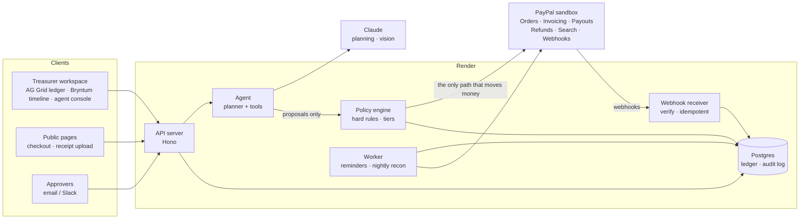

# Autonomous Treasurer

An AI treasurer for student clubs and community events. It collects registration fees, invoices sponsors, reimburses volunteers, pays prize winners, issues refunds and reconciles everything. **PayPal executes every money movement.** The agent does the reading, reasoning, matching and explaining, inside a governance layer that it cannot talk its way around.

> Built for the "Build What's Next with PayPal and AI" hackathon. Licence: [MIT](LICENSE).
>
> **Demo video:** [YouTube link, coming soon] · **Live demo:** [Render URL, coming soon] · **API walkthrough:** [Postman collection](postman/autonomous-treasurer.postman_collection.json)

## The problem

Student clubs handle real money with no finance staff, no tooling, and a treasurer who changes every year. The money for one event lives in a Google Form, a payment link, a spreadsheet, a WhatsApp group of receipt photos, and email threads with sponsors. Teams get marked as paid when they haven't paid. Volunteers wait weeks to be reimbursed. Spending gets approved in chat, and the closing statement is rebuilt by hand from bank history.

## What it does

| # | Feature | PayPal |
|---|---|---|
| C1 | **Registration and team payments.** Pay alone or as a team, or split the fee with a personal link per teammate. The agent finds partially paid teams and drafts the nudge. | Orders v2 |
| C2 | **Sponsor invoicing.** Paste a sponsor's email; the agent extracts tier, amount and due date, drafts the invoice, and times the reminders. | Invoicing v2 |
| C3 | **Receipt-to-reimbursement.** A volunteer uploads a photo. Vision extraction, totals re-added in code, budget-line mapping, duplicate detection. | Payouts v1 |
| C4 | **Tiered approvals.** Every outgoing payment becomes an approval card routed by amount: what it is, why, and the budget impact. | Gates C3, C5, S1 |
| C5 | **Prize payouts.** Paste the winners list. It is checked against registrations and paid in one idempotent batch. | Payouts v1 (batch) |
| C6 | **Reconciliation.** Webhooks keep the ledger live; every PayPal transaction is matched or explained. | Webhooks, Transaction Search |
| S1 | **Cancellation refunds.** "Refund everyone in Workshop B" becomes a preview, then a bulk refund. | Payments v2 |

### Governed autonomy

The agent acts on shared money, but it can only **propose**. Every proposal passes deterministic hard rules before any human sees it: per-transaction cap, budget-line cap, recipient allowlist, daily cap, duplicate guard and refund bound. Approval is then routed by amount (auto under $50, treasurer up to $500, treasurer and faculty advisor above that). Text from receipts, emails and web pages is passed to the model as delimited data, never as instructions. A vendor quote with hidden instructions can trick the agent into proposing a $900 payment to an unknown account, and the recipient rule blocks it.

**Numbers come from code.** No figure the model writes ever reaches a user. On approval cards and nudges, the model writes the wording around `{slots}` such as `{amount}` and `{remaining_after}`. Code rejects any draft containing a digit, currency symbol or link the model typed itself, then fills each slot with a value the backend computed. See [`packages/comms/src/slots.ts`](packages/comms/src/slots.ts).

## Architecture



The agent process never holds a credential that can move money. Only the policy engine does.

### Repository layout

```
apps/
  api/        Hono API: public endpoints, staff endpoints, PayPal webhooks
  web/        Next.js: treasurer workspace + public pages (/e/:slug/...)
  worker/     Cron jobs: nightly reconciliation, reminders, payout polling
packages/
  shared/     Money in integer cents, domain enums, the SpendProposal contract
  db/         Drizzle schema + migrations (Postgres, or embedded PGlite locally)
  paypal/     PayPal REST client (OAuth, PayPal-Request-Id on every write)
  llm/        Claude client: schema-validated output, retries, untrusted-data wrapper
  agent/      Agent loop, propose_* tools, plan preview
  policy/     Hard rules, YAML policy loader, tier routing, AI intent check
  documents/  Receipt and sponsor-email extraction, budget-line classifier
  recon/      Seed data, deterministic matcher, closing statement
  comms/      Approval explainer, nudge/reminder writer, prize-list parser and batch preview
policies/     Per-event policy files (approval tiers, caps, recipient rules)
postman/      Postman collection + environment
docs/         Ownership map, demo script, submission kit
```

[`docs/ownership.md`](docs/ownership.md) lists who owns each package and the contracts between them.

## Run it locally

Requires **Node 22+**. No Postgres is needed: without `DATABASE_URL`, the app uses an embedded PGlite database in `./.data`.

```bash
git clone <repo-url> && cd autonomous_treasurer
npm install
cp .env.example .env          # add PayPal sandbox + Anthropic keys (see below)
npm run db:migrate
npm run seed                  # demo event: 300 registrations with planted errors
npm run dev                   # API on :4000, web on :3000
```

Then open http://localhost:3000/e/hackfest for the public pages, and http://localhost:3000/workspace for the treasurer workspace.

Without an Anthropic key, every AI-written message falls back to a deterministic template. Without PayPal keys, the checkout endpoints return 503 and everything else still works.

### PayPal sandbox setup

1. At [developer.paypal.com](https://developer.paypal.com) create a sandbox **Business** account (the club) and add balance to it. Payouts fail with insufficient funds otherwise.
2. Create several sandbox **Personal** accounts: participants, volunteers, prize winners and one per sponsor.
3. Create a REST app on the Business account with **Payouts**, **Invoicing** and **Transaction Search** enabled. Put its credentials in `PAYPAL_CLIENT_ID` / `PAYPAL_CLIENT_SECRET`, and the client id in `NEXT_PUBLIC_PAYPAL_CLIENT_ID`.
4. Register a webhook for `https://<api-host>/webhooks/paypal` and put its id in `PAYPAL_WEBHOOK_ID`.
5. Use **USD** and **email** recipients. The sandbox does not support phone recipients.

### Tests

```bash
npm run typecheck
npm test
```

Tests run against an in-memory PGlite database and a fake LLM. They never call PayPal or a real model.

### Deploy

[`render.yaml`](render.yaml) is a Render Blueprint: Postgres, the API (migrations run before each deploy), the web app, and a nightly cron for reconciliation.

## AI evaluation

| Eval | Set | Result |
|---|---|---|
| Receipt extraction (vendor, total) | 20–30 labelled receipt photos in `evals/receipts` | _TBD (AI 2)_ |
| Reconciliation | 300 seeded registrations with planted duplicates, wrong amounts and orphan payments | _TBD (AI 4)_ |
| Prompt injection | Instructions hidden in a receipt, a sponsor email and a vendor page | _TBD (AI 3)_ |
| Approval cards and nudges | Every LLM draft is checked for model-typed figures and links | Enforced in code; covered by unit tests |

## Tools used

| Tool | How we used it |
|---|---|
| **PayPal** REST APIs (Orders, Invoicing, Payouts, Payments, Transaction Search, Webhooks) | The execution layer for every money movement |
| **PayPal Agent Toolkit** | Read-only tools for the agent (orders, invoices, transactions) |
| **PayPal JS SDK** (`@paypal/react-paypal-js`) | Checkout buttons on the public registration and team payment pages |
| **Claude** (Anthropic API) | Agent planning, receipt vision, extraction, reconciliation explanations, approval and nudge wording |
| **Render** | Hosts the API, web app, webhook endpoint, nightly cron and Postgres |
| **AG Grid** | Ledger and reconciliation console _(Dev 2)_ |
| **Bryntum** | Event timeline with payment milestones _(Dev 2)_ |
| **Postman** | Public collection walking through the API and sandbox flows; webhook testing |
| Next.js, Hono, Drizzle ORM, PGlite, Zod, Vitest | App framework, API, database access, validation, tests |

## Team

| Person | Role |
|---|---|
| Dev 1 | Platform and PayPal |
| Dev 2 | Frontend |
| AI 1 | Agent lead and integrator |
| AI 2 | Document intelligence |
| AI 3 | Policy and safety |
| AI 4 | Reconciliation and data |
| AI 5 | Comms, payouts and story |

## Licence

[MIT](LICENSE)
